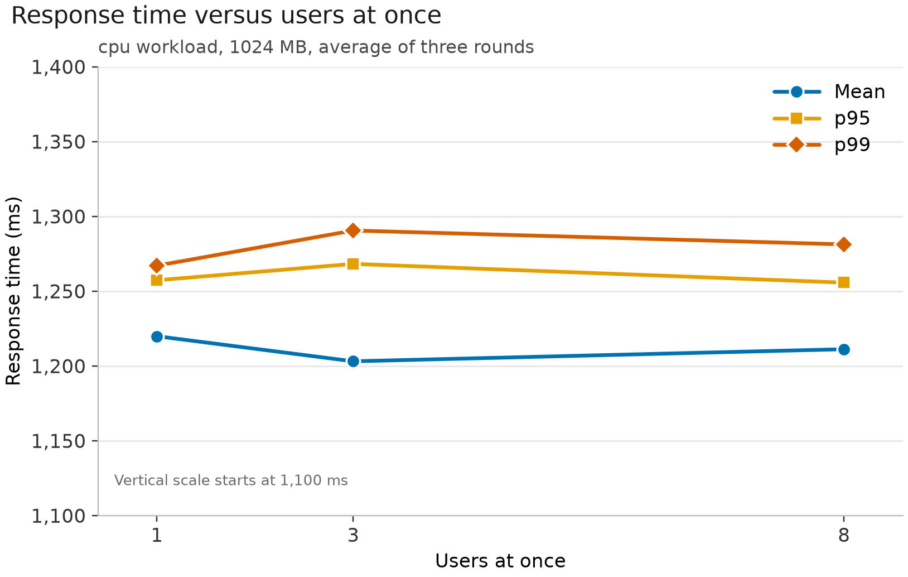

# RQ2: do more users at once slow response time?

## Question and setup

This question measures how the number of users at once changes mean, p95, and p99 response time. The workload counts primes up to 500,000, and memory stays at 1024 MB. The three levels are 1, 3, and 8 users (`cpu-1024-low`, `cpu-1024`, and `cpu-1024-high`). The 3-user level is the same run the memory question uses as its 1024 MB cpu point and the workload question uses as its cpu bar. Each level ran once on 24 October, 31 October, and 1 November, from one laptop in Calgary to Lambda in us-west-2. Each user sends the next request as soon as the previous one returns. The first 30 seconds of each run are warm-up and are left out. The measured window is 120 seconds. A request counts as successful only when the response body is correct. Each round is summarised on its own, then the three summaries are averaged. The standard deviation is the average of the standard deviations inside each run. The round-by-round table shows how far the three days sit from each other.

## Graph 3

Mean, p95, and p99 response time against users at once. The vertical axis starts at 1,100 ms so the three lines can be told apart. All of the points fall between about 1,200 and 1,290 ms.

## Round-average results

Each value is the average of the three rounds. Execution time is how long the function ran inside AWS. Overhead is response time minus execution time: the network and front-end delay.

| Users | Setup | Mean (ms) | Median (ms) | Std. dev. (ms) | p95 (ms) | p99 (ms) | Execution (ms) | Overhead (ms) | Throughput (req/s) | Failure rate | Peak concurrency | Cold starts |
|---:|---|---:|---:|---:|---:|---:|---:|---:|---:|---:|---:|---:|
| 1 | `cpu-1024-low` | 1,219.9 | 1,213.3 | 19.2 | 1,257.3 | 1,267.1 | 1,179.0 | 40.9 | 0.82 | 0 | 1.33 | 0.00 |
| 3 | `cpu-1024` | 1,203.1 | 1,192.4 | 42.7 | 1,268.3 | 1,290.5 | 1,168.5 | 34.6 | 2.49 | 0 | 3.00 | 0.00 |
| 8 | `cpu-1024-high` | 1,211.2 | 1,211.7 | 33.9 | 1,255.7 | 1,281.3 | 1,176.8 | 34.5 | 6.61 | 0 | 8.67 | 0.00 |

## The three rounds

Each configuration was repeated on three separate days. Little's Law deviation is how far (requests per second × mean response time) sits from the number of users, as a percentage. Failed requests cover throttles, function errors, timeouts, and wrong answers.

| Round | Users | Requests | Mean (ms) | p95 (ms) | p99 (ms) | Throughput (req/s) | Little's law | Deviation (%) | Peak concurrency | Cold starts | Failed |
|---:|---:|---:|---:|---:|---:|---:|---:|---:|---:|---:|---:|
| 1 | 1 | 95 | 1,271.2 | 1,336.3 | 1,356.2 | 0.79 | 1.006 | 0.64 | 1 | 0 | 0 |
| 2 | 1 | 105 | 1,139.9 | 1,156.9 | 1,159.7 | 0.88 | 0.997 | 0.26 | 1 | 0 | 0 |
| 3 | 1 | 96 | 1,248.6 | 1,278.8 | 1,285.3 | 0.80 | 0.999 | 0.11 | 2 | 0 | 0 |
| 1 | 3 | 292 | 1,234.0 | 1,287.5 | 1,338.4 | 2.43 | 3.003 | 0.09 | 3 | 0 | 0 |
| 2 | 3 | 304 | 1,181.4 | 1,283.8 | 1,290.5 | 2.53 | 2.993 | 0.24 | 3 | 0 | 0 |
| 3 | 3 | 301 | 1,194.1 | 1,233.4 | 1,242.7 | 2.51 | 2.995 | 0.16 | 3 | 0 | 0 |
| 1 | 8 | 787 | 1,219.2 | 1,264.1 | 1,314.5 | 6.56 | 7.996 | 0.05 | 9 | 0 | 0 |
| 2 | 8 | 793 | 1,212.2 | 1,267.3 | 1,279.8 | 6.61 | 8.011 | 0.13 | 9 | 0 | 0 |
| 3 | 8 | 798 | 1,202.2 | 1,235.7 | 1,249.5 | 6.65 | 7.995 | 0.06 | 8 | 0 | 0 |

## Interpretation

Mean, median, p95, and p99 stay about the same from 1 user to 8. Averaged over the three rounds they are 1,219.9 / 1,203.1 / 1,211.2 ms (mean), 1,213.3 / 1,192.4 / 1,211.7 ms (median), 1,257.3 / 1,268.3 / 1,255.7 ms (p95), and 1,267.1 / 1,290.5 / 1,281.3 ms (p99). From 1 user to 8, the mean changes by -8.7 ms (-0.7%), p95 by -1.6 ms (-0.1%), and p99 by +14.2 ms (+1.1%). p99 sits 47.2 ms, 87.4 ms, and 70.0 ms above the mean, so the slowest requests stay close to the average.

The change from 1 user to 8 is smaller than the difference between rounds. The 1-user means in rounds 1, 2, and 3 are 1,271.2, 1,139.9, and 1,248.6 ms, a range of 131.3 ms. The 3-user means cover 52.6 ms and the 8-user means cover 17.0 ms. Round 2 with 1 user is the fast one. Across all nine runs, 3,571 measured requests had 0 failures, covering throttles (HTTP 429), function errors, timeouts, and wrong answers.

Most of the response time is the prime-counting work inside the function. AWS execution time averages 1,179.0, 1,168.5, and 1,176.8 ms. Overhead, response time minus execution time, averages 40.9, 34.6, and 34.5 ms, in line with the network delay from Calgary to Oregon. Successful throughput rises from 0.82 to 2.49 to 6.61 requests per second, about 1, 3, and 8 times the 1-user rate. Little's Law stays within 0.64% of the configured users on every run. The largest gap is round 1 with 1 user. With no pause between requests, the added users show up as higher throughput.

Peak concurrency averages 1.3, 3.0, and 8.7. A one-minute CloudWatch reading can sit a little above the user count when that minute also includes the warm-up. The peaks stay under the account limit of 10, and no request was throttled. None of the nine runs had a cold start in the 120-second measurement window. Cold starts in the other setups were kept in the results.

The runs use 1, 3, and 8 users. The original plan was 1, 10, and 50. The account allows only 10 concurrent executions and AWS declined the increase, so these runs stay under that limit and the memory and workload questions use 3 users for the same reason. At 1, 3, and 8 users each request still gets its own execution environment, and response time stays level. Queueing and throttling once the account limit is reached were outside these runs.

The 3-user run, `cpu-1024`, is one measurement shared with the other two questions. The memory question keeps 3 users and changes memory. On that same cpu workload the mean response time is 2,402.9 ms at 512 MB, 1,203.1 ms at 1024 MB, and 749.2 ms at 1769 MB, because Lambda attaches more CPU as memory increases. That is a change in how long one request takes. With memory held at 1024 MB, raising users from 1 to 8 leaves response time level and raises throughput. The workload question compares api, cpu, and data at 1024 MB and 3 users: 34.7 ms, 1,203.1 ms, and 756.4 ms. Their overhead is 33.1 ms, 34.6 ms, and 38.4 ms, the same Calgary-to-Oregon delay measured here. On these cpu runs that delay sits on top of about 1,168.5 ms of execution, which is why response time follows the function time as the user count changes. `api-1024` and `data-1024` are shared by the memory and workload questions only. The three rounds already show that the change with users is smaller than the change from day to day. Confidence intervals will be added in the final report.

## Main results table

Mean, median, standard deviation, p95, p99, successful throughput, and failure rate for all 11 setups, averaged across the three rounds. The memory comparison uses the nine rows with 3 users. The workload comparison uses `api-1024`, `cpu-1024`, and `data-1024`. Those rows are this same set of runs.

| Setup | Workload | Memory (MB) | Users | Mean (ms) | Median (ms) | Std. dev. (ms) | p95 (ms) | p99 (ms) | Throughput (req/s) | Failure rate |
|---|---|---:|---:|---:|---:|---:|---:|---:|---:|---:|
| `api-512` | api | 512 | 3 | 35.1 | 34.6 | 3.3 | 39.8 | 46.2 | 84.71 | 0 |
| `api-1024` | api | 1024 | 3 | 34.7 | 34.3 | 3.2 | 39.1 | 45.1 | 85.97 | 0 |
| `api-1769` | api | 1769 | 3 | 35.1 | 34.7 | 2.7 | 39.3 | 45.1 | 84.82 | 0 |
| `cpu-512` | cpu | 512 | 3 | 2,402.9 | 2,409.1 | 90.4 | 2,532.8 | 2,564.7 | 1.25 | 0 |
| `cpu-1024` | cpu | 1024 | 3 | 1,203.1 | 1,192.4 | 42.7 | 1,268.3 | 1,290.5 | 2.49 | 0 |
| `cpu-1769` | cpu | 1769 | 3 | 749.2 | 750.7 | 25.0 | 788.1 | 812.1 | 4.01 | 0 |
| `data-512` | data | 512 | 3 | 1,476.6 | 1,467.6 | 38.0 | 1,542.0 | 1,579.3 | 2.03 | 0 |
| `data-1024` | data | 1024 | 3 | 756.4 | 722.5 | 69.5 | 870.2 | 896.6 | 3.98 | 0 |
| `data-1769` | data | 1769 | 3 | 430.0 | 424.0 | 21.7 | 470.9 | 490.1 | 6.97 | 0 |
| `cpu-1024-low` | cpu | 1024 | 1 | 1,219.9 | 1,213.3 | 19.2 | 1,257.3 | 1,267.1 | 0.82 | 0 |
| `cpu-1024-high` | cpu | 1024 | 8 | 1,211.2 | 1,211.7 | 33.9 | 1,255.7 | 1,281.3 | 6.61 | 0 |

## Individual contribution

Muneeb analysed how the number of users at once affects response time: graph 3, the results table for all 11 setups, and the round-by-round comparison of mean, median, p95, p99, throughput, failures, cold starts, peak concurrency, and Little's Law.

## Round 1 check

Round 1 on its own, for comparison with the expected values of about 1,271 / 1,234 / 1,219 ms (mean), 1,336 / 1,288 / 1,264 ms (p95), and 1,356 / 1,338 / 1,315 ms (p99). The tables above use all three rounds.

- 1 user: mean 1,271.2 ms, p95 1,336.3 ms, p99 1,356.2 ms
- 3 users: mean 1,234.0 ms, p95 1,287.5 ms, p99 1,338.4 ms
- 8 users: mean 1,219.2 ms, p95 1,264.1 ms, p99 1,314.5 ms
