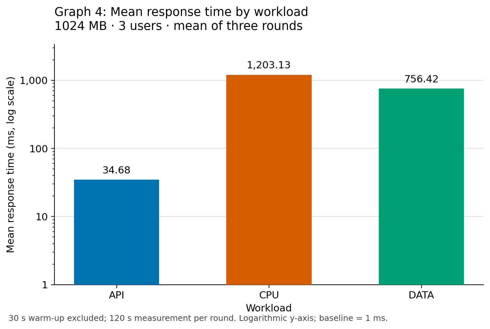
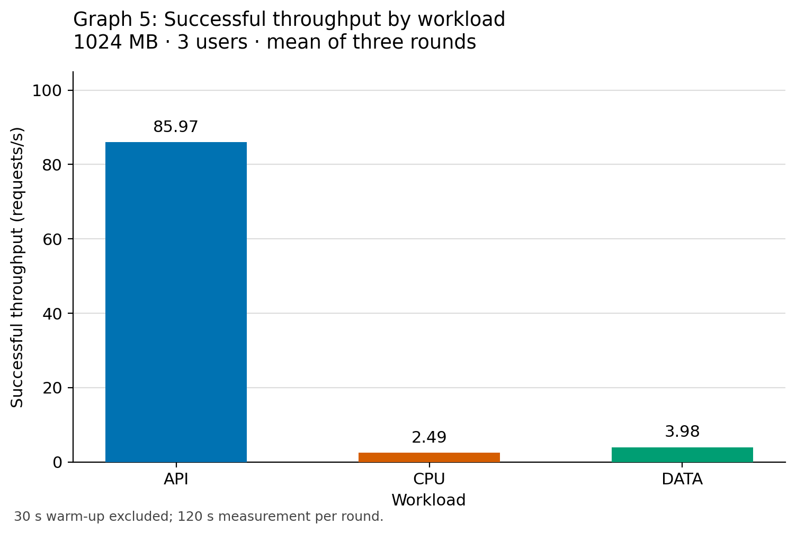

# RQ3: How do workload types compare?

## Question and controlled comparison

RQ3 compares API validation, CPU computation, and in-memory data processing under the same allocation of **1024 MB and three concurrent users**. The configurations are `api-1024`, `cpu-1024`, and `data-1024`; the low- and high-user CPU configurations are excluded. The `cpu-1024` measurement is shared with RQ1 and RQ2, while `api-1024` and `data-1024` are shared with RQ1. These are shared observations, not additional independent experiments.

Each configuration was run once in each of three rounds, on 24 October, 31 October, and 1 November 2026. Each run lasted 150 seconds: requests sent in the first 30 seconds were warm-up and excluded, leaving a 120-second measurement window. Results come from Member 1's [per_config.csv](per_config.csv) and [per_run.csv](per_run.csv). Each metric is calculated per run and then averaged equally across the three rounds; requests from different rounds are not pooled.

The original proposal used 10 users for this comparison. The collected data uses the restricted profile of three users because the AWS account allows 10 concurrent executions and 100 requests/s, and the requested quota increase was declined. These results describe the restricted profile.

## Graph 4: Mean response time



Mean client-observed response time at 1024 MB and three users, averaged across three rounds. The y-axis is logarithmic with a 1 ms baseline, as required by the analysis guide; bar heights should be read against the tick values rather than compared as linear lengths. Labels give the exact plotted values rounded to two decimal places. API averages 34.68 ms, CPU 1,203.13 ms, and data 756.42 ms.

## Graph 5: Successful throughput



Successful requests per second at 1024 MB and three users, averaged across three rounds. The y-axis is linear and starts at zero. Throughput is the number of requests with `valid == true` divided by 120 seconds for each run, then averaged across rounds. API averages 85.97 requests/s, CPU 2.49 requests/s, and data 3.98 requests/s. Success requires HTTP 200, the expected workload and memory, `ok == true`, and an exact match to the expected result.

## RQ3 supporting table

All values below are three-round averages. Execution is AWS Lambda REPORT duration for the measured requests matched by request ID. Overhead is mean client response time minus mean AWS execution duration, encompassing network and service front-end effects; it is a residual, not an isolated measurement of network latency.

| Workload | Memory (MB) | Users | Mean response (ms) | Successful throughput (requests/s) | Execution (ms) | Overhead (ms) |
|---|---:|---:|---:|---:|---:|---:|
| API | 1024 | 3 | 34.68 | 85.97 | 1.60 | 33.09 |
| CPU | 1024 | 3 | 1,203.13 | 2.49 | 1,168.49 | 34.63 |
| Data | 1024 | 3 | 756.42 | 3.98 | 718.04 | 38.38 |

The execution and overhead columns are the required RQ3 supporting metrics. [rq3_supporting_table.csv](rq3_supporting_table.csv) retains the input precision; displayed rounded components can differ from their displayed sum by 0.01 ms.

## Summary and explanation

At 1024 MB and three concurrent users, the API workload had the lowest mean response time (34.68 ms) and highest successful throughput (85.97 requests/s), followed by data processing (756.42 ms; 3.98 requests/s) and CPU computation (1,203.13 ms; 2.49 requests/s). CPU response time was approximately 34.69 times API response time and 1.59 times data response time. The API handler only validates and echoes a small request: its 1.60 ms execution duration accounts for about 4.6% of response time, with the remaining 95.4% represented by overhead. In contrast, execution accounts for about 97.1% of CPU response time and 94.9% of data response time. The CPU handler counts primes up to 500,000 by trial division; the data handler sorts, filters, and aggregates 300,000 in-memory records. Thus the observed CPU and data response times are dominated by function execution, while API response time is dominated by overhead. With a fixed number of users sending requests back to back, faster responses also permit greater throughput. These observations apply to the particular implementations and input sizes tested.

The data workload creates its seeded dataset once when an execution environment is initialized. Each request still performs a full sort, filter, and aggregation. It does not fetch records from a database or remote storage, so its results should be described as in-memory processing rather than database or storage I/O performance. The common response handling and workload code are in [functions/](../functions/), and the frozen sizes and expected answers are in [experiment.json](../config/experiment.json).

## Repetition and quality checks

| Round | Workload | Measured requests | Mean response (ms) | Successful throughput (requests/s) | Execution (ms) | Overhead (ms) |
|---:|---|---:|---:|---:|---:|---:|
| 1 | API | 9,502 | 37.55 | 79.18 | 1.56 | 35.99 |
| 1 | CPU | 292 | 1,233.96 | 2.43 | 1,192.02 | 41.94 |
| 1 | Data | 450 | 801.77 | 3.75 | 750.29 | 51.48 |
| 2 | API | 10,833 | 32.94 | 90.28 | 1.50 | 31.44 |
| 2 | CPU | 304 | 1,181.36 | 2.53 | 1,150.94 | 30.42 |
| 2 | Data | 513 | 699.69 | 4.28 | 667.95 | 31.74 |
| 3 | API | 10,614 | 33.57 | 88.45 | 1.73 | 31.84 |
| 3 | CPU | 301 | 1,194.06 | 2.51 | 1,162.52 | 31.55 |
| 3 | Data | 470 | 767.79 | 3.92 | 735.86 | 31.93 |

The nine RQ3 runs contain 33,279 measured requests with no failures, throttles, function errors, timeouts, or wrong answers. One measured cold start occurred in API during round 2 and was retained. No measured CPU or data cold starts occurred in this comparison. Member 1's [checks](checks.md) mark all nine runs PASS; Little's Law deviations are below 1.1%. [rq3_per_round.csv](rq3_per_round.csv) provides the unrounded round-level values and cold-start counts.

The ordering API < data < CPU for response time holds in every round. Mean response time ranges from 32.94–37.55 ms for API, 1,181.36–1,233.96 ms for CPU, and 699.69–801.77 ms for data. These ranges show variation between rounds; they are not confidence intervals. This preliminary comparison has three repetitions per configuration and makes no claim of statistical significance or maximum sustainable capacity. The fixed-user, zero-think-time experiment links throughput to response time and does not independently sweep offered request rates.

## Load-generator location, hardware, and method


| Load-generator detail | Recorded value |
|---|---|
| Location | Calgary, Alberta, Canada (documented in the repository) |
| Laptop make/model | |
| CPU model | |
| RAM | |
| Operating system and version | |
| k6 version | |
| Actual network connection / wired confirmation | |
| Same machine and network used for all rounds — confirmation | |

Source: [load-test method](../loadtest/README.md), [test configurations](../loadtest/TEST-CONFIGURATIONS.md), [k6 implementation](../loadtest/run.js), and the round-order files under `results/round*/k6-measured-data/`. The AWS host configuration is documented separately in the [repository README](../README.md); its hardware is not the load-generator hardware.

## Reproduce the RQ3 artifacts

With Python and matplotlib installed, run from the repository root:

```sh
python3 analysis/rq3_workloads.py
```

The script reads the existing summary CSVs, verifies one configuration at 1024 MB and three users for each workload, checks one run in each of three rounds, verifies the averages and response/execution/overhead relationship, and writes only the two RQ3 PNGs and the two RQ3 CSV tables. It does not modify source data or Member 1's tables. The write-up is maintained separately in this file. No load tests, AWS exports, or deployments are needed to reproduce these artifacts.

## Individual contribution — Erioluwa (Member 4)

Erioluwa's RQ3 contribution comprises the reproducible workload-comparison script, graphs 4 and 5, the execution-duration and overhead supporting table, the round-by-round comparison, and the interpretation of API, CPU, and data results at 1024 MB and three users. This section documents the load-generation method and location, preserves the shared data and calculations, and identifies the hardware fields awaiting completion by the test operator.
