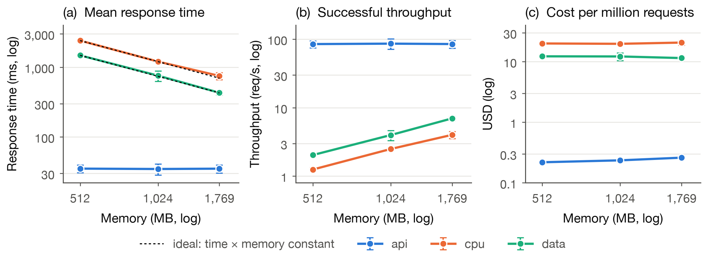
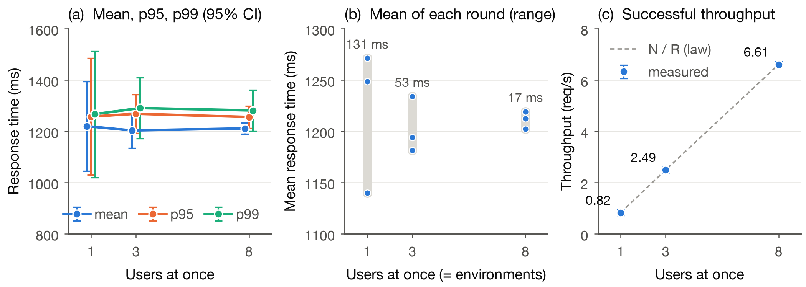
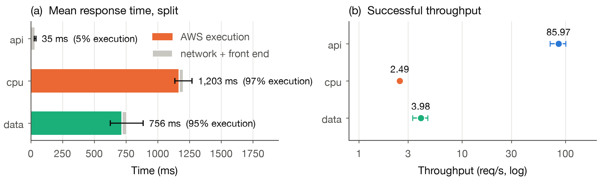
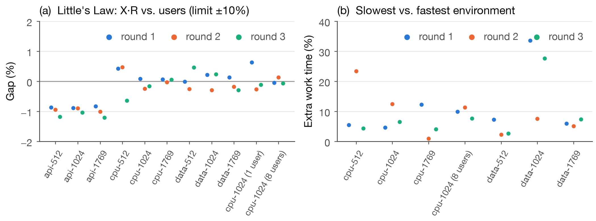

**Study in brief.** We measure how memory (512, 1024, 1769 MB), concurrent users and workload type (API, CPU-bound, data sort) change AWS Lambda response time and throughput. **RQ1:** effect of memory. **RQ2:** effect of concurrency on mean, p95 and p99. **RQ3:** differences between workloads. Every table and figure is rebuilt from the raw data in the group repository by the scripts in `analysis/`.

# 1. Status update

## 1.1 Summary

All 11 configurations ran in 3 randomized rounds: 33 runs, 102,119 measured requests. Every request returned HTTP 200 with a correct body, and every run passed the Little's Law check, so none was repeated. The analysis pipeline, results with 95% confidence intervals, and this report are complete.

## 1.2 Progress against the proposal milestones

| Proposal milestone | Planned | Completed | Status | Exit criterion and evidence |
|:---|:---|:---|:---|:---|
| Setup: AWS access, concurrency quota check, three handlers, Function URLs, k6 scripts | Oct 3–9 | by Oct 24 | **Complete** | *All three functions return correct responses.* Nine functions deployed with AWS CDK. Quota found to be 10 (Section 2). |
| Pilot: calibrate input sizes, validate the measurement pipeline | Oct 10–16 | by Oct 24 | **Complete** | *Input sizes frozen; pipeline validated.* Primes to 500,000; 300,000 records. Each k6 request joins its AWS log line by request id. |
| Randomized run order; Round 1 (11 configurations) | Oct 17–23 | Oct 24 | **Complete** | *Round 1 stored with labels.* `results/round1/` |
| Rounds 2 and 3 on separate days | Oct 24–30 | Oct 31, Nov 1 | **Complete** | *All 33 runs complete.* 0 failed requests, 0 runs repeated |
| Analysis scripts; graphs and tables; infrastructure; contributions | Oct 17–Nov 6 | Nov 1–6 | **Complete** | *Midterm report submitted.* `analysis/`, this report |
| 95% confidence intervals | Nov 23–29 | Nov 5 | **Complete, ahead of plan** | Every table and figure in Section 3 |
| Little's Law consistency check | Oct 10–16 (pilot) | Nov 1, all 33 runs | **Complete, extended** | Run on all 33 runs, not only the pilot (Section 3.6) |

: Progress against the milestones of the proposal.

**Schedule.** Every milestone due before the midterm is met. Data collection finished on 1 November, before this report, as the proposal required. The measurement rounds ran about one week after their planned window. The timeline absorbs this: two later tasks, the confidence intervals and the Little's Law check on every run, are already done. The remaining milestones (Table 3) keep the proposal's dates through the final report on 13 December.

# 2. Plan adjustments

## 2.1 Changes to the plan

| Proposal | Now | Reason and effect |
|:---|:---|:---|
| 10 users for RQ1 and RQ3 | **3 users** | The account allows 10 concurrent executions, and AWS declined our request to raise it. At 3 users every run stays under the limit, and no request was throttled (0 HTTP 429). |
| 1, 10 and 50 users for RQ2 | **1, 3 and 8 users** | Same quota. RQ2 now covers the light-load region. Behaviour at the quota is added in Phase 2 (Table 3). |
| Cold starts recorded, not a factor | Unchanged | 6 cold starts in 102,119 measured requests, kept in the data. |
| All other settings | Unchanged | Memory levels, workloads, region, runtime, 30 s warm-up, 120 s measurement, 3 randomized rounds, 11 configurations. |

: Changes to the plan.

The 11 configurations still answer all three questions. RQ1 uses the nine memory × workload configurations at 3 users. RQ2 uses `cpu-1024` at 1, 3 and 8 users. RQ3 uses `api-1024`, `cpu-1024` and `data-1024`. The configuration `cpu-1024` (1024 MB, 3 users) is shared by all three questions.

## 2.2 Updated milestones

The proposal planned a Phase 2 with new levels for the factor that has the largest effect. Section 3 shows that this factor is memory. Phase 2 also adds the concurrency levels that the quota change removed.

| Dates | Task | Exit criterion |
|:---|:---|:---|
| Nov 9–15 | Address midterm feedback. Run **Rounds 4 and 5** for `cpu-1024-low` and `data-1024`, whose intervals are too wide to separate small effects (Section 3.6). | 5 rounds for both configurations |
| Nov 9–22 | **Phase 2, memory:** add 256 MB and 3008 MB for `cpu` and `data` at 3 users. 3008 MB tests whether single-threaded code gains anything past one vCPU. 128 MB is excluded because `data` uses 132 MB. **Phase 2, quota:** run `cpu-1024` at 10 and 12 users to measure response time and throttling at the account limit. | Final dataset frozen Nov 22 |
| Nov 23–29 | Statistical comparison of configurations; interpretation for each question | Results and figures complete |
| Nov 30–Dec 4 | Final report draft; publish code and data in a public repository | Complete draft |
| Dec 5–13 | Peer review, revisions, formatting, references | Final report submitted Dec 13 |

: Updated milestones.

# 3. Preliminary results

## 3.1 Analysis method

Each run is summarised on its own. Only requests in the 120 s measurement window count. The response-time statistics are the mean, median, standard deviation, p95 and p99 of the k6 request duration. Successful throughput X is the number of correct responses divided by 120 s. The three rounds are then averaged; requests from different runs are never pooled. The "±" values and error bars are 95% confidence intervals for that average, $\bar{x} \pm t_{0.975,\,2}\, s/\sqrt{3}$, where $t = 4.303$ and $s$ is the standard deviation of the three round values. With three rounds the intervals are wide, so we treat a difference as real only when the intervals do not overlap. Execution time comes from the Lambda REPORT log line for the same request. Overhead is response time minus execution time, which covers the network, TLS and the Function URL front end.

## 3.2 Results for all configurations

| Setup | MB | Users | Mean (ms) | Median (ms) | SD (ms) | p95 (ms) | p99 (ms) | X (req/s) |
|:---|---:|---:|---:|---:|---:|---:|---:|---:|
| api-512 | 512 | 3 | 35.1 ± 4.5 | 34.6 | 3.3 | 39.8 ± 7.2 | 46.2 ± 17.3 | 84.71 ± 10.32 |
| api-1024 | 1024 | 3 | 34.7 ± 6.2 | 34.3 | 3.2 | 39.1 ± 6.9 | 45.1 ± 7.9 | 85.97 ± 14.78 |
| api-1769 | 1769 | 3 | 35.1 ± 4.7 | 34.7 | 2.7 | 39.3 ± 5.1 | 45.1 ± 6.2 | 84.82 ± 10.78 |
| cpu-512 | 512 | 3 | 2,402.9 ± 137.6 | 2,409.1 | 90.4 | 2,532.8 ± 92.9 | 2,564.7 ± 100.7 | 1.25 ± 0.07 |
| cpu-1024 | 1024 | 3 | 1,203.1 ± 68.2 | 1,192.4 | 42.7 | 1,268.3 ± 75.1 | 1,290.5 ± 118.9 | 2.49 ± 0.13 |
| cpu-1769 | 1769 | 3 | 749.2 ± 86.3 | 750.7 | 25.0 | 788.1 ± 142.6 | 812.1 ± 177.7 | 4.01 ± 0.46 |
| data-512 | 512 | 3 | 1,476.6 ± 40.6 | 1,467.6 | 38.0 | 1,542.0 ± 107.6 | 1,579.3 ± 168.1 | 2.03 ± 0.07 |
| data-1024 | 1024 | 3 | 756.4 ± 129.1 | 722.5 | 69.5 | 870.2 ± 301.4 | 896.6 ± 342.0 | 3.98 ± 0.67 |
| data-1769 | 1769 | 3 | 430.0 ± 32.3 | 424.0 | 21.7 | 470.9 ± 87.4 | 490.1 ± 74.9 | 6.97 ± 0.48 |
| cpu-1024-low | 1024 | 1 | 1,219.9 ± 174.4 | 1,213.3 | 19.2 | 1,257.3 ± 227.6 | 1,267.1 ± 247.2 | 0.82 ± 0.11 |
| cpu-1024-high | 1024 | 8 | 1,211.2 ± 21.2 | 1,211.7 | 33.9 | 1,255.7 ± 43.3 | 1,281.3 ± 80.7 | 6.61 ± 0.11 |

: Primary metrics, mean of 3 rounds ± 95% CI. The failure rate is 0 for every configuration: no throttles, function errors, timeouts or wrong answers.

| Setup | Execution (ms) | Overhead (ms) | Max mem. (MB) | Cost/1M req. (USD) | Cold starts/run | Peak conc. |
|:---|---:|---:|---:|---:|---:|---:|
| api-512 | 1.7 ± 0.3 | 33.4 ± 4.2 | 34 | 0.22 ± 0.00 | 0.33 | 3.3 |
| api-1024 | 1.6 ± 0.3 | 33.1 ± 6.3 | 34 | 0.23 ± 0.00 | 0.33 | 3.3 |
| api-1769 | 1.6 ± 0.4 | 33.5 ± 5.0 | 34 | 0.26 ± 0.01 | 0.00 | 3.0 |
| cpu-512 | 2,368.8 ± 117.0 | 34.1 ± 25.3 | 33 | 19.95 ± 0.97 | 0.67 | 4.0 |
| cpu-1024 | 1,168.5 ± 52.6 | 34.6 ± 15.8 | 34 | 19.68 ± 0.88 | 0.00 | 3.0 |
| cpu-1769 | 709.2 ± 63.4 | 40.0 ± 26.6 | 33 | 20.63 ± 1.83 | 0.00 | 3.0 |
| data-512 | 1,442.5 ± 42.4 | 34.1 ± 24.4 | 132 | 12.23 ± 0.34 | 0.33 | 3.7 |
| data-1024 | 718.0 ± 109.2 | 38.4 ± 28.2 | 132 | 12.18 ± 1.82 | 0.00 | 3.0 |
| data-1769 | 390.2 ± 3.0 | 39.8 ± 29.3 | 132 | 11.46 ± 0.07 | 0.33 | 3.3 |
| cpu-1024-low | 1,179.0 ± 151.1 | 40.9 ± 34.3 | 34 | 19.86 ± 2.52 | 0.00 | 1.3 |
| cpu-1024-high | 1,176.8 ± 12.8 | 34.5 ± 14.1 | 34 | 19.82 ± 0.21 | 0.00 | 8.7 |

: Secondary metrics from the AWS logs, mean of 3 rounds ± 95% CI. Cost is mean billed time × memory (GB) × \$0.0000166667 per GB-second, plus \$0.20 per million requests (x86, us-west-2). Peak concurrency is the largest one-minute CloudWatch maximum during the run.

## 3.3 RQ1: memory allocation

**More memory makes compute-bound work faster in proportion, at almost no extra cost.** From 512 to 1769 MB, `cpu` mean response time falls from 2,403 to 749 ms (3.21×). `data` falls from 1,477 to 430 ms (3.43×). Lambda allocates CPU in proportion to memory, so the ideal speed-up is 1769 / 512 = 3.46×, and both workloads lie close to that line (Figure 1a). For `cpu` and `data`, no two memory levels have overlapping intervals. The only shortfall is `cpu` from 1024 to 1769 MB: 1.61× against an ideal 1.73×, which is inside the interval. Phase 2 tests it with more levels. Throughput rises by the same factors (Figure 1b), as the response-time law X = N / R requires when the number of users N is fixed.

`api` does not change with memory: 35.1, 34.7 and 35.1 ms, with overlapping intervals. Its function runs for only 1.6 ms. The remaining 33 ms is network and front end, which more memory cannot reduce.

Cost per million requests is flat across memory levels (Figure 1c): about \$20 for `cpu`, \$11–12 for `data` and \$0.22–0.26 for `api`. Lambda bills GB-seconds, so doubling memory while halving duration costs the same. For `cpu` and `data`, 1769 MB therefore gives 3.2–3.4× faster responses for the same price. For `api`, more memory adds 19% to the cost and no speed. Memory actually used stays at 34 MB (`api`, `cpu`) or 132 MB (`data`), so the extra allocation buys CPU, not memory.

## 3.4 RQ2: concurrency

**From 1 to 8 users, response time does not change measurably.** The mean is 1,220, 1,203 and 1,211 ms, and p99 is 1,267, 1,291 and 1,281 ms. All intervals overlap (Figure 2a). The largest difference between levels, +24 ms in p99, is much smaller than the interval widths. Execution time is also flat: 1,179, 1,169 and 1,177 ms. Lambda runs each concurrent request in its own execution environment, and peak concurrency follows the user count (1.3, 3.0, 8.7). There is therefore no shared queue to wait in. Throughput grows linearly with users and sits on the X = N / R line (Figure 2c): 0.82, 2.49 and 6.61 req/s. These levels are in the light-load region of a closed system. The knee, where throughput levels off and response time grows, is expected at the 10-execution quota, beyond our current levels. Phase 2 measures it.

**More users made the results more repeatable.** The spread of the mean across rounds falls from 131 ms at 1 user to 53 ms at 3 users and 17 ms at 8 users (Figure 2b). At 1 user, every request in a run goes to one environment. Environments differ in speed (Section 3.6), so the run mean depends on the environment the run received. At 8 users, each run averages over 8 environments. In Round 2, the 1-user run was the fast outlier (1,140 ms). Its execution time (1,109 ms) was also the lowest, so the difference came from the function, not from the network.

## 3.5 RQ3: workload type

**The workloads differ in where the time goes, not only in how much time they take.** At the same memory and load, `api` responds in 34.7 ms, `data` in 756 ms and `cpu` in 1,203 ms. All three intervals are separate. Only 5% of the `api` response time is function execution; the rest is the round trip from Calgary to Oregon. `cpu` and `data` spend 97% and 95% of the time in execution. This split decides which setting helps: memory (RQ1) speeds up `cpu` and `data`, and it does nothing for `api`, whose response time is set by distance. Throughput follows the same order: 86.0, 3.98 and 2.49 req/s. Overhead is the same for all three workloads (33–38 ms, overlapping intervals), so it is a property of the network path, not of the function.

## 3.6 Validity of the measurements

**The load generator kept up.** In a closed system with zero think time, Little's Law requires X × R = N. The gap is at most 1.2% on every run (Figure 4a), well inside the 10% repeat rule from the proposal, so k6 was not a bottleneck. The `api` runs sit about 1% low. Their requests are short, so the client's time between one response and the next request is a visible part of each cycle.

**Lambda execution environments are not identical.** Within one run, the slowest environment needed 7% more work time than the fastest (median over runs), and three runs exceeded 15% (Figure 4b). In `data-1024`, Rounds 1 and 3 each had one environment about 30% slower than the other two (906 against about 680 ms). This environment explains the widest p95 and p99 intervals in Table 4, and a mean (756 ms) above the median (723 ms). The variation comes from AWS, not from our setup. It is the reason for the extra rounds in Table 3.

**Round 1 had a slower network.** Overhead averaged 45 ms in Round 1, against 31–32 ms in Rounds 2 and 3. This widens the overhead intervals in Table 5. It does not affect execution time, and the randomized run order spreads it across all configurations.

## 3.7 Summary of preliminary findings

| Question | Finding so far | Next step |
|:---|:---|:---|
| RQ1, memory | `cpu` and `data` speed up in proportion to memory (3.2–3.4× from 512 to 1769 MB) at a flat cost. `api` is unaffected. | Phase 2: 256 and 3008 MB, to find where scaling stops |
| RQ2, concurrency | No measurable change in mean, p95 or p99 from 1 to 8 users. Throughput follows X = N / R. | Phase 2: 10 and 12 users, to reach the quota |
| RQ3, workload | `api` time is 95% network; `cpu` and `data` time is 95–97% execution. | Relate to the RQ1 memory effect in the final report |

: Preliminary answers to the research questions.

# 4. Infrastructure details

## 4.1 System hosting

The system under test runs on **AWS Lambda in us-west-2 (Oregon)**. There are nine functions, `seng533-{api,cpu,data}-{512,1024,1769}`, one for each workload and memory level. All nine share one code asset; only the handler and the memory size differ. Each function has its own Function URL, with authentication `NONE`, buffered responses, and no API Gateway or VPC. The infrastructure is defined in AWS CDK (`infra/`) and deployed from GitHub Actions. Nothing was redeployed during a round.

## 4.2 Workload generation and load-generator location

**k6** generates the load from **one laptop in Calgary, on a wired network**. The laptop is a separate machine from the system under test, which runs in AWS, so the load generator does not compete with the functions for resources. The scripts also run on the laptop: `loadtest/round.sh` runs a round, `loadtest/run.sh` runs one configuration, and `loadtest/run.js` is the k6 test. After each round, a GitHub Actions workflow runs `tools/export_aws_data.py` on a GitHub-hosted runner to export the matching CloudWatch REPORT lines and metrics. The analysis scripts in `analysis/` run on a team member's machine and read only the stored files.

## 4.3 Hardware specifications

| Component | Specification |
|:---|:---|
| Lambda functions | x86_64, Python 3.12 managed runtime, standard library only. Memory 512, 1024 or 1769 MB. CPU is allocated in proportion to memory, with one full vCPU at 1769 MB. Timeout 30 s; ephemeral storage 512 MB; no reserved or provisioned concurrency; no SnapStart; X-Ray off. Account limit: 10 concurrent executions. |
| Load-generator laptop | **[Hamd to fill: model, CPU, RAM]** |
| Operating system | **[Hamd to fill]** |
| k6 version | **[Hamd to fill]** (`k6 version`) |
| Network | Wired Ethernet in Calgary, AB; the same machine and network for all rounds |

: Hardware of the system under test and the load generator.

## 4.4 Testing setup and procedure

Each k6 virtual user sends its next request as soon as the previous one returns. The system is closed, with zero think time, and uses the `constant-vus` executor. Every request is the same POST with a small JSON body. Each run follows these steps:

1. Select the configuration: one function URL and its number of users.
2. Run k6 for 150 s. Requests sent in the first 30 s are tagged warm-up and excluded. The next 120 s are measured.
3. Check each response against the frozen expected answer in `config/experiment.json`. A request is successful only if the status is 200 and the body is correct.
4. Write one line per request with its timing, status, success flag and AWS request id.
5. Pause 40 s, then start the next configuration.

`round.sh` runs the 11 configurations one at a time, in a new random order each round. The rounds started on 24 October at 8:01 pm, 31 October at 2:13 pm and 1 November at 10:36 am (Calgary time). `analysis/build_tables.py` joins every measured request to its AWS log line by request id. It stops on any missing or duplicate record, and seven unit tests cover it. Four scripts draw the figures: `rq1_memory.py`, `rq2_users.py`, `rq3_workloads.py` and `validity.py`.

# 5. Individual contributions

| Member | Contribution |
|:---|:---|
| Hamd | AWS account and quota request; CDK infrastructure and CI/CD; Lambda handlers; k6 load-test scripts; ran all three rounds and the AWS exports; analysis guide |
| Naveed | `build_tables.py` and its tests: per-run and per-configuration tables, joining k6 to AWS data, Little's Law and failure checks for all 33 runs |
| Muneeb | RQ2 analysis (Figure 2); confidence intervals; validity analysis and the environment-speed finding (Figure 4); figure scripts; report integration |
| Alessandra | RQ1 analysis: memory graphs and the execution, memory and cost results (Figure 1, Table 5) |
| Erioluwa | RQ3 analysis: workload graphs and the execution versus overhead split (Figure 3); load-generator details |

: Individual contributions.
